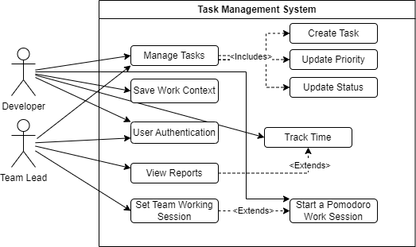
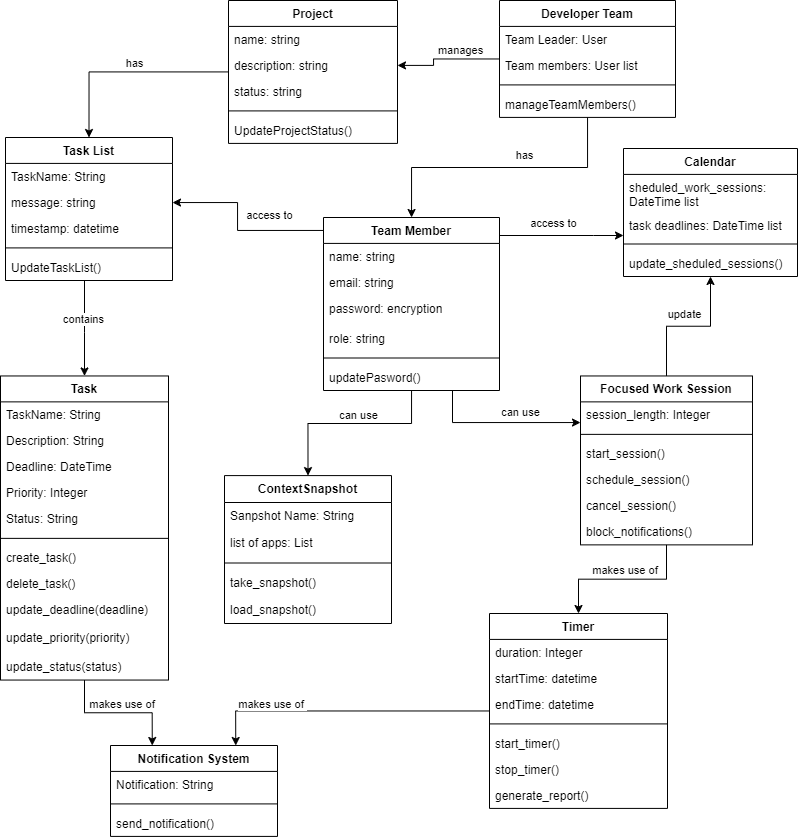

# DevFocus

A desktop task management app for software developers, built with **Electron**, **React**, **Node.js/Express** and **MongoDB**.

I built DevFocus as the prototype for my Software Engineering project at IU International University of Applied Sciences (2024). Developers often juggle several projects, get interrupted constantly and lose focus when they switch between tasks. DevFocus combines project and task tracking with focused work sessions in one place.

## Features

- **Dashboard:** one starting point for the app's tools.
- **Task Manager:** create projects with their own task lists, pick a project to see its tasks, and save everything to MongoDB through the backend API.
- **Focused Work Sessions:** a Pomodoro timer with 25-minute work sessions and 5-minute breaks.

## Tech stack

| Layer | Technology |
| --- | --- |
| Desktop shell | Electron (Electron Forge + Webpack) |
| Front end | React 18, React Router, Axios, react-timer-hook |
| Back end | Node.js, Express |
| Database | MongoDB (Mongoose) |

## Design

The project started from a requirements specification and system design. Two of the models from the project report:

**Use case model**



**Object model**



## Running it locally

You need [Node.js](https://nodejs.org/) and a MongoDB database. A free [MongoDB Atlas](https://www.mongodb.com/atlas) cluster works.

**1. Start the backend API** (runs on port 5000)

```bash
cd backend-server
npm install
cp .env.example .env   # then put your MongoDB connection string in .env
node server.js
```

The connection string is read from `backend-server/.env`, which is git-ignored, so credentials never end up in the repository.

**2. Start the desktop app** (in a second terminal, from the project root)

```bash
npm install
npm start
```

## API

| Method | Endpoint | Description |
| --- | --- | --- |
| GET | `/api/data` | Returns all projects with their task lists |
| POST | `/api/upload` | Saves a new project and its tasks |

## Author

Gerhard Eckley · [GitHub](https://github.com/RoyalStevieG)
